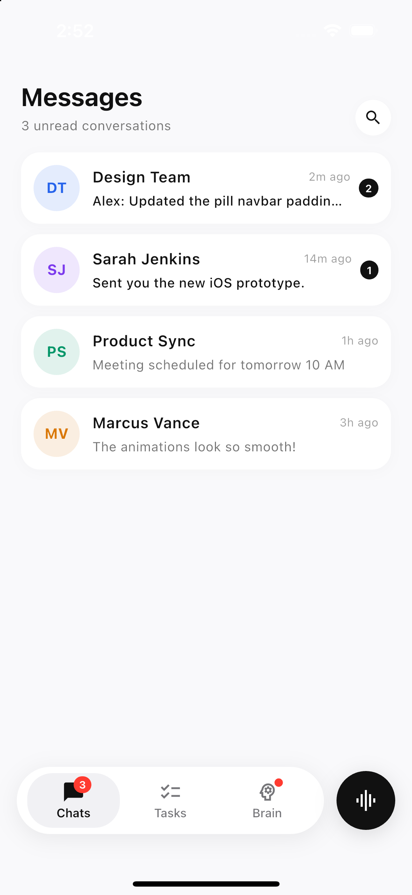

# 💊 floating_pill_navbar

[](https://pub.dev/packages/floating_pill_navbar)
[](https://pub.dev/packages/floating_pill_navbar/score)
[](https://github.com/roshan-codes/floating_pill_navbar/blob/main/LICENSE)
[](https://dart.dev/guides/language/effective-dart)

A beautiful, customizable floating pill-shaped bottom navigation bar with a companion circular action button for Flutter. ✨

Inspired by modern, minimal iOS design patterns — featuring smoothly rounded capsule corners, soft depth shadows, subtle tactile press animations, and dynamic badge counters. 🚀

---

## 📱 Visual Preview

<div align="center">
  
  <p><em>Live iOS 18 rendering with 3 destinations, unread badge counter, notification dot, and audio action button.</em></p>
</div>

---

## ✨ Features That Shine

- 💊 **Floating Pill Container**: Smooth capsule corners with subtle, natural drop shadows.
- 🔘 **Detached Action Button**: Circular companion floating action button with tactile press spring scaling.
- 💫 **Silky Micro-Interactions**: Smooth capsule selection movement and color transitions.
- 🔢 **Dynamic Destinations**: Seamlessly supports 2, 3, 4, 5+ navigation items with automatic width distribution.
- 🔴 **Smart Notification Badges**: Supports counters (`3`), unread dots, and customizable overflow limits (`99+`).
- 🌙 **Deep Dark Mode Support**: Ready-to-go `FloatingPillThemeData.dark()` presets.
- 🛡️ **Zero Dependencies**: Pure Flutter SDK implementation with zero external bloat.
- ♿ **Accessible & Responsive**: Built-in RTL layout direction, SafeArea insets, and screen adaptability.

---

## 📦 Installation

Add `floating_pill_navbar` to your `pubspec.yaml`:

```yaml
dependencies:
  floating_pill_navbar: ^1.0.0
```

Then run:

```bash
flutter pub get
```

Import it in your Dart code:

```dart
import 'package:floating_pill_navbar/floating_pill_navbar.dart';
```

---

## 🚀 Quick Start

Drop `FloatingPillNavBar` straight into your `Scaffold.bottomNavigationBar`:

```dart
int _selectedIndex = 0;

@override
Widget build(BuildContext context) {
  return Scaffold(
    body: _pages[_selectedIndex],
    bottomNavigationBar: FloatingPillNavBar(
      selectedIndex: _selectedIndex,
      onDestinationSelected: (index) {
        setState(() => _selectedIndex = index);
      },
      destinations: const [
        FloatingPillDestination(
          icon: Icons.chat_bubble_outline,
          selectedIcon: Icons.chat_bubble,
          label: 'Chats',
          badge: FloatingPillBadge.count(3),
        ),
        FloatingPillDestination(
          icon: Icons.checklist_outlined,
          selectedIcon: Icons.checklist,
          label: 'Tasks',
        ),
        FloatingPillDestination(
          icon: Icons.psychology_outlined,
          selectedIcon: Icons.psychology,
          label: 'Brain',
          badge: FloatingPillBadge.dot(),
        ),
      ],
      actionButton: FloatingPillAction(
        icon: Icons.graphic_eq,
        tooltip: 'Voice command',
        onPressed: () {
          // 🎙️ Action button tapped!
        },
      ),
    ),
  );
}
```

---

## 🎨 Creative Customizations

### 🔴 1. Interactive Badges & Alert Dots

Easily add unread message counts or subtle alert dots:

```dart
FloatingPillDestination(
  icon: Icons.mail_outline,
  selectedIcon: Icons.mail,
  label: 'Inbox',
  badge: FloatingPillBadge.count(
    120,
    maxCount: 99, // Displays 99+
    backgroundColor: Color(0xFFFF3B30),
  ),
),
FloatingPillDestination(
  icon: Icons.notifications_none,
  selectedIcon: Icons.notifications,
  label: 'Alerts',
  badge: FloatingPillBadge.dot(
    backgroundColor: Colors.amber,
  ),
),
```

### 🌙 2. Dark Mode Out-of-the-Box

Switch seamlessly between clean light and dark appearances:

```dart
FloatingPillNavBar(
  selectedIndex: _selectedIndex,
  backgroundColor: const Color(0xFF1C1C1E),
  selectedBackgroundColor: const Color(0xFF2C2C2E),
  selectedIconColor: Colors.white,
  selectedLabelColor: Colors.white,
  unselectedIconColor: const Color(0xFF8E8E93),
  unselectedLabelColor: const Color(0xFF8E8E93),
  onDestinationSelected: (i) => setState(() => _selectedIndex = i),
  destinations: _destinations,
  actionButton: FloatingPillAction(
    icon: Icons.graphic_eq,
    backgroundColor: Colors.white,
    foregroundColor: Colors.black,
    onPressed: () {},
  ),
)
```

### ⚡ 3. Custom Action Button (Gradients & Custom Widgets)

Pass any custom Flutter widget into the action button:

```dart
actionButton: FloatingPillAction(
  size: 58,
  tooltip: 'Create New',
  child: Container(
    width: 58,
    height: 58,
    decoration: const BoxDecoration(
      shape: BoxShape.circle,
      gradient: LinearGradient(
        colors: [Color(0xFFFF512F), Color(0xFFDD2476)],
      ),
    ),
    child: const Icon(Icons.add, color: Colors.white, size: 28),
  ),
  onPressed: () => print('Created!'),
)
```

### 💫 4. Custom Animation Curves

Tweak durations and curves to fit your brand's motion identity:

```dart
FloatingPillNavBar(
  selectedIndex: _selectedIndex,
  animationDuration: const Duration(milliseconds: 350),
  animationCurve: Curves.easeOutCubic,
  enableAnimation: true,
  enableHapticFeedback: true, // 📳 Tactile haptic click on iOS/Android
  destinations: _destinations,
)
```

### 🚫 5. Standalone Pill (Without Action Button)

Prefer just the navigation pill? Simply omit `actionButton`:

```dart
FloatingPillNavBar(
  selectedIndex: _selectedIndex,
  onDestinationSelected: (i) => setState(() => _selectedIndex = i),
  destinations: _destinations,
)
```

---

## 🛠️ API Reference

### `FloatingPillNavBar`

| Property | Type | Default | Description |
|---|---|---|---|
| `selectedIndex` | `int` | *required* | Current active destination index |
| `destinations` | `List<FloatingPillDestination>` | *required* | List of navigation items |
| `onDestinationSelected` | `ValueChanged<int>?` | `null` | Callback when an item is tapped |
| `actionButton` | `FloatingPillAction?` | `null` | Companion circular action button |
| `backgroundColor` | `Color?` | `Colors.white` | Navigation container background |
| `height` | `double?` | `64.0` | Navigation container height |
| `borderRadius` | `BorderRadiusGeometry?` | `BorderRadius.circular(32)` | Corner radius of the container |
| `margin` | `EdgeInsetsGeometry?` | `EdgeInsets.only(16, 0, 16, 24)` | Outer margin surrounding the navbar |
| `selectedBackgroundColor` | `Color?` | `Color(0xFFF1F1F4)` | Capsule highlight background |
| `selectedIconColor` | `Color?` | `Color(0xFF111111)` | Active icon color |
| `selectedLabelColor` | `Color?` | `Color(0xFF111111)` | Active label color |
| `unselectedIconColor` | `Color?` | `Color(0xFF757579)` | Inactive icon color |
| `unselectedLabelColor` | `Color?` | `Color(0xFF757579)` | Inactive label color |
| `animationDuration` | `Duration?` | `250ms` | Duration of selection transitions |
| `animationCurve` | `Curve?` | `Curves.easeInOut` | Curve for selection transitions |
| `enableHapticFeedback` | `bool?` | `true` | Haptic click on selection |
| `useSafeArea` | `bool` | `true` | Adapts to bottom home indicator insets |

---

## 📄 License

This project is licensed under the MIT License — see the [LICENSE](LICENSE) file for details.
